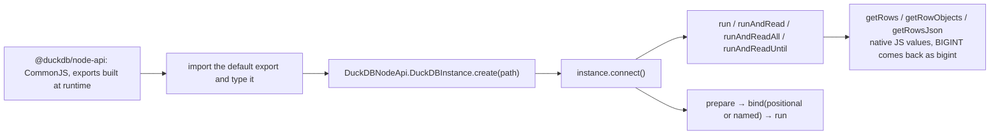

`ktjs-duckdb-node-neo` declares `@duckdb/node-api@2.0.0-r.1`, DuckDB's native client for Node: no
wasm, no worker, real threads and real files.

## One thing to know first

`@duckdb/node-api` is a CommonJS package whose exports are built at runtime, so an ESM
`import { DuckDBInstance }` fails with a `Named export not found` error. The wrapper therefore
imports the module's default export and types it, and re-exposes the classes through
`DuckDBNodeApi`:

```kotlin
import io.github.shijianjs.ktjs.duckdb.node.DuckDBNodeApi

DuckDBNodeApi.DuckDBInstance.create(":memory:")
```

`create` takes a file path — `":memory:"` for an in-memory database. (Passing a Kotlin `null` for
"no path" is not the same thing: upstream validates the argument as a string.)



## Connect and run

```kotlin
DuckDBNodeApi.DuckDBInstance.create(":memory:")
    .then { instance ->
        instance.connect().then { connection ->
            connection.runAndReadAll("SELECT 42 AS answer").then { reader ->
                val answer = reader.value(0.0, 0.0)
                println(answer)
                reader.closeSync()
                connection.closeSync()
                instance.closeSync()
            }
        }
    }
```

`run` executes without reading, `runAndRead` returns a `DuckDBResult`, `runAndReadAll` returns a
`DuckDBMaterializedResult` (rows in chunks), and `runAndReadUntil` stops at a row limit.

## Values

The reader gives back native JS values, which the wrapper keeps as `JsAny` because a single result
column can hold `number`, `bigint`, `string`, `boolean`, `null`, list or object depending on its
type:

```kotlin
val rows = reader.getRows()       // Array<Array<DuckDBValue>>
val objects = reader.getRowObjects()  // one object per row, keyed by column name
val json = reader.getRowsJson()   // the JSON representation
```

`range()` columns are `BIGINT`, i.e. JS `bigint`; compare them as text or cast deliberately rather
than assuming `number`. `columnTypesJson()` / `columnType(i)` describe what each column holds, and
`DuckDBTypeId` names the ids.

## Prepared statements

```kotlin
val prepared = connection.prepare("SELECT ?::INTEGER + 1 AS answer")
prepared.bind(1.0)       // positional, by index
prepared.bind("x")       // or by name, for named parameters
```

`bind` accepts a `JsAny` for the same reason `getRows` returns one: the parameter value is typed by
the statement. `run`, `runAndRead` and `runAndReadAll` execute it, `clearBindings` resets it, and
`destroySync` frees it.

## What is not modelled

`DuckDBAppender` (bulk insert, 30+ typed `append*` methods), the full `DuckDBValue` union
(`DuckDBListValue`, `DuckDBStructValue`, …) and `DuckDBTypeId`'s derived value types are out of
scope for this pass; they are listed with reasons in `docs/development/node-api-coverage.md`.
