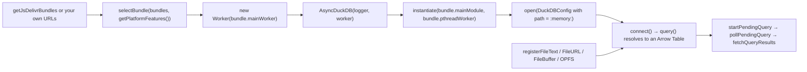

`ktjs-duckdb-wasm` declares the browser-facing `@duckdb/duckdb-wasm@1.32.0`: the async database handle,
its connections, prepared statements, the file registry and the bundle selection helpers.

## Bundles

`1.32.0` is the npm stable line the module is modelled on. The package ships three builds, and the
wrapper keeps the platform helper that picks one:

```kotlin
import io.github.shijianjs.ktjs.duckdb.wasm.getPlatformFeatures
import io.github.shijianjs.ktjs.duckdb.wasm.selectBundle

val bundles = getJsDelivrBundles()      // or your own paths
val bundle = selectBundle(bundles, getPlatformFeatures())
```

A bundle exposes `mainModule` (the `.wasm` URL), `mainWorker` (the worker script URL), and, for the
cross-origin-isolated `coi` build, `pthreadWorker`. `selectBundle` is async because the platform
features it reads are async.



## Instantiate and query

```kotlin
val worker = Worker(bundle.mainWorker!!)
val db = AsyncDuckDB(consoleLogger(LogLevels.WARNING), worker)

db.instantiate(bundle.mainModule, bundle.pthreadWorker)
    .then { db.open(unsafeJso<DuckDBConfig> { path = ":memory:" }) }
    .then { db.connect() }
    .then { connection -> connection.query("SELECT 1 AS n") }
```

The constructor takes the logger and the worker only — upstream creates no worker itself, so the
caller owns its lifetime (and `isNode` decides whether a worker exists at all).

## Files and tables

The browser build cannot open a path, so data goes in through the file registry:

```kotlin
db.registerFileText("people.csv", csvText)
db.insertCSVFromPath("people.csv", unsafeJso<CSVInsertOptions> {
    schema = "main"
    name = "people"
    create = true
})
```

`registerFileURL`, `registerFileBuffer`, `registerEmptyFileBuffer` and `registerOPFSFileName` cover
the other sources; `dropFile`, `dropFiles` and `flushFiles` manage the registry, and
`copyFileToBuffer` / `copyFileToPath` move files out.

DuckDB's own Arrow output lands as Arrow tables, hence the dependency on the arrow module:
`connection.query()` resolves to `Table`, and `insertArrowTable` / `insertArrowFromIPCStream` take
one back in.

## Prepared statements and streaming

```kotlin
val prepared = connection.prepare("SELECT ?::INTEGER + 1 AS answer")
prepared.query(1.0)
```

`startPendingQuery` / `pollPendingQuery` / `fetchQueryResults` / `cancelPendingQuery` are the
incremental path for large results, and `AsyncResultStreamIterator` wraps them into `next()`.

## Configuration

`DuckDBConfig` carries `path`, `accessMode`, `maximumThreads`, `useDirectIO`, `query`,
`filesystem`, `allowUnsignedExtensions`, `arrowLosslessConversion`, `customUserAgent` and `opfs`.
Every member is optional, so `unsafeJso<DuckDBConfig> { path = ":memory:" }` is a legal config; the
`AccessMode` value type is `AccessModes.AUTOMATIC` / `READ_ONLY` / `READ_WRITE`.

## Node?

The same package has a Node entry point upstream, but this module declares the browser surface only.
Server-side use goes through `ktjs-duckdb-node-neo` instead, which is the native client and needs no
wasm at all.
