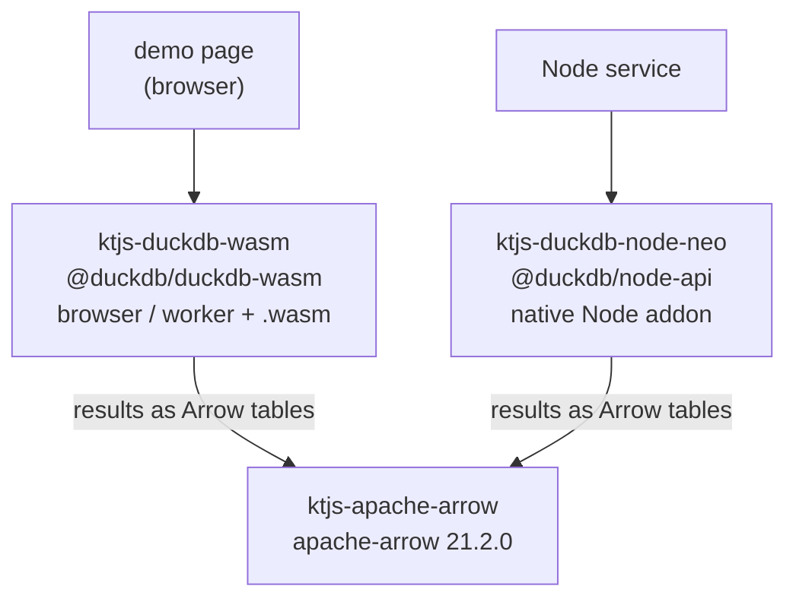

`kmp-duckdb` wraps three upstream npm packages in type-checked Kotlin/JS declarations, so a Kotlin
project can talk to DuckDB and read its results as Apache Arrow tables without falling back to
hand-written JavaScript interop.

| Module | Upstream npm package | What it covers |
| --- | --- | --- |
| `ktjs-apache-arrow` | [`apache-arrow`](https://www.npmjs.com/package/apache-arrow) | data types, `Data`, `Vector`, `RecordBatch`, `Table`, schemas, builders and the IPC serialization functions |
| `ktjs-duckdb-wasm` | [`@duckdb/duckdb-wasm`](https://www.npmjs.com/package/@duckdb/duckdb-wasm) | `AsyncDuckDB`, connections, prepared statements, the logger, configs, registered files and insert options |
| `ktjs-duckdb-node-neo` | [`@duckdb/node-api`](https://www.npmjs.com/package/@duckdb/node-api) | `DuckDBInstance`, `DuckDBConnection`, prepared statements and the result reader |

Every module follows one rule: a type upstream declares is a type the Kotlin compiler checks. A `Type`
enum member is not a `Double`, a `'file' | 'stream'` argument is not a `String`, and a column vector is
typed by its values rather than by `JsAny`.

## Why the three modules are separate

The three upstream packages are used in different environments and evolve on different schedules:

- `apache-arrow` is pure TypeScript and runs in browsers, workers and Node;
- `@duckdb/duckdb-wasm` needs a browser worker plus a `.wasm` binary and only makes sense in a page or
  a worker;
- `@duckdb/node-api` loads a native Node addon and only runs on the server.

Keeping them apart means a browser page pulls neither the native addon nor its typings, and a Node
service does not pull a `.wasm` build it cannot instantiate. `ktjs-duckdb-wasm` and
`ktjs-duckdb-node-neo` both depend on `ktjs-apache-arrow`, because both hand results back as Arrow
tables — so the arrow module is the common vocabulary of the other two.

The arrow module is the shared vocabulary: both DuckDB clients hand their results back as Arrow
tables, so the type that crosses the boundary is the same on the server and in the page.

## Where to go next

- **[Getting started](../guide/getting-started)** — add the modules to a project and run a first query.
- **[Apache Arrow](../guide/apache-arrow)** — how a table is built, read and serialized.
- **[DuckDB WASM](../guide/duckdb-wasm)** — instantiating the database in a browser page.
- **[DuckDB Node](../guide/duckdb-node)** — the native Node client.
- **[Demo](https://shijianjs.github.io/kmp-duckdb/demo/)** — the same code running in a page.
- **[API reference](https://shijianjs.github.io/kmp-duckdb/api/)** — the generated Dokka pages.

## Versions

The module version is derived from the wrapped npm version: `ktjs-apache-arrow:21.2.0-kt.1` wraps
`apache-arrow@21.2.0`, and the `-kt.N` suffix counts wrapper revisions for that same upstream version.
Revisions are recorded per module in `wrapper-revisions.properties` in the repository.
