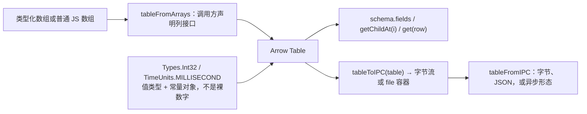

# Apache Arrow

`ktjs-apache-arrow` 声明了 `apache-arrow@21.2.0` 的公开接口。Arrow 是 DuckDB 返回结果的数据格式，
所以读取结果的每条路径都要经过这个模块。



## 构造表

```kotlin
import io.github.shijianjs.ktjs.duckdb.arrow.tableFromArrays
import js.buffer.ArrayBufferLike
import js.objects.unsafeJso
import js.typedarrays.Int32Array

external interface IdColumn {
    var id: Int32Array<ArrayBufferLike>
}

val ids = Int32Array<ArrayBufferLike>(3)
ids[0] = 10
ids[1] = 20
ids[2] = 30

val table = tableFromArrays(unsafeJso<IdColumn> { id = ids })
```

`tableFromArrays` 接收一个「列对象」；每列是 typed array 或普通 JS 数组。上游参数类型是
`Record<string, T[] | TypedArray>`，封装保留为带类型的 `JsAny` 参数加调用方声明的接口，因此列名仍会被检查。

## 读取表

```kotlin
val fields = table.schema.fields          // 名称、类型、是否可空、元数据
val column = table.getChildAt(0.0)        // Vector<JsAny>?，一列
val value = column?.get(1.0)              // 20.0
```

也可以按行读取：`table.get(0.0)` 返回 `StructRow`，字段按名字访问。

## 序列化

```kotlin
import io.github.shijianjs.ktjs.duckdb.arrow.IPCTypes
import io.github.shijianjs.ktjs.duckdb.arrow.tableFromIPC
import io.github.shijianjs.ktjs.duckdb.arrow.tableToIPC

val bytes = tableToIPC(table)                     // 上游默认：stream 容器
val fileBytes = tableToIPC(table, IPCTypes.file, null)  // file 容器，不压缩
val restored = tableFromIPC(bytes)
```

`tableFromIPC` 有三个 Kotlin 入口：字节（`ArrowBytes`）、Arrow 的 JSON 表示（`String`），以及
`tableFromIPCAsync`（上游原名，通过 `@JsName` 保留）用于 `Response`、blob、可读流或其 Promise。

## 类型，而不是数字

Arrow 的枚举是数值型 TypeScript 枚举，封装把每个都建模为值类型加常量对象，因此要求 `Type` 的成员
拿不到任意数字：

```kotlin
Int32().typeId                   // Types.Int32，而不是 -4.0
Utf8().isUtf8                    // 与上游 isUtf8() 对应的扩展属性
Timestamp(TimeUnits.MILLISECOND) // 单位被检查，而不是传数字
```

IPC 容器（`IPCWriteType` 与 `IPCTypes.file` / `IPCTypes.stream`）、`Data` 的 buffer 槽位
（`BufferType`）同理。

## 尚未建模的部分

封装覆盖 DuckDB 使用方需要的部分：数据类型、`Field`/`Schema`、`Data`、`Vector`、`RecordBatch`、
`Table`、表级 builder、类型守卫与 IPC 函数。其余上游接口——各类型的 builder（`IntBuilder` 等）、
visitor、message 与 record batch 的读写器、`compressionRegistry` 以及 `util` 命名空间——记录在
`docs/development/arrow-coverage.md`，让缺口可见而不是被隐含。
