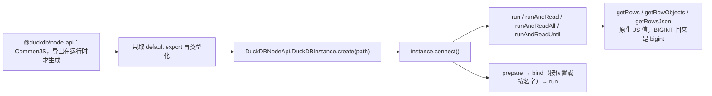

# DuckDB Node 客户端

`ktjs-duckdb-node-neo` 声明 `@duckdb/node-api@2.0.0-r.1`，即 DuckDB 面向 Node 的原生客户端：不用 wasm、
不用 worker，有真正的线程与文件。

## 先要知道一件事

`@duckdb/node-api` 是 CommonJS 包，导出对象在运行时组装，所以在 ESM 里写
`import { DuckDBInstance }` 会报 `Named export not found`。封装因此导入模块的 default 导出并为其声明类型，
再通过 `DuckDBNodeApi` 重新暴露这些类：

```kotlin
import io.github.shijianjs.ktjs.duckdb.node.DuckDBNodeApi

DuckDBNodeApi.DuckDBInstance.create(":memory:")
```

`create` 接收文件路径——内存数据库写 `":memory:"`。（用 Kotlin 的 `null` 表示「不要路径」在这里不等价：
上游会把该参数当作字符串校验。）



## 连接与执行

```kotlin
DuckDBNodeApi.DuckDBInstance.create(":memory:")
    .then { instance ->
        instance.connect().then { connection ->
            connection.runAndReadAll("SELECT 42 AS answer").then { reader ->
                val answer = reader.value(0.0, 0.0)
                println(answer)
                reader.closeSync()
                connection.closeSync()
                instance.closeSync()
            }
        }
    }
```

`run` 只执行不读取，`runAndRead` 返回 `DuckDBResult`，`runAndReadAll` 返回 `DuckDBMaterializedResult`
（按 chunk 组织行），`runAndReadUntil` 在行数上限处停止。

## 值

reader 返回原生 JS 值；封装保留为 `JsAny`，因为同一列按类型可能是 `number`、`bigint`、`string`、
`boolean`、`null`、列表或对象：

```kotlin
val rows = reader.getRows()       // Array<Array<DuckDBValue>>
val objects = reader.getRowObjects()  // 每行一个对象，键为列名
val json = reader.getRowsJson()   // JSON 表示
```

`range()` 的列是 `BIGINT`，也就是 JS `bigint`；按文本比较或显式转换，不要假定是 `number`。
`columnTypesJson()` / `columnType(i)` 描述每列装什么，`DuckDBTypeId` 给出 id 名称。

## 预处理语句

```kotlin
val prepared = connection.prepare("SELECT ?::INTEGER + 1 AS answer")
prepared.bind(1.0)       // 位置参数，按索引
prepared.bind("x")       // 或按名字，用于命名参数
```

`bind` 接收 `JsAny`，原因与 `getRows` 相同：参数值由语句本身决定类型。`run`、`runAndRead`、
`runAndReadAll` 执行它，`clearBindings` 复位，`destroySync` 释放。

## 尚未建模的部分

`DuckDBAppender`（批量插入，30+ 个带类型的 `append*` 方法）、完整的 `DuckDBValue` 联合
（`DuckDBListValue`、`DuckDBStructValue` 等）以及 `DuckDBTypeId` 派生的值类型本轮不覆盖；理由记录在
`docs/development/node-api-coverage.md`。
