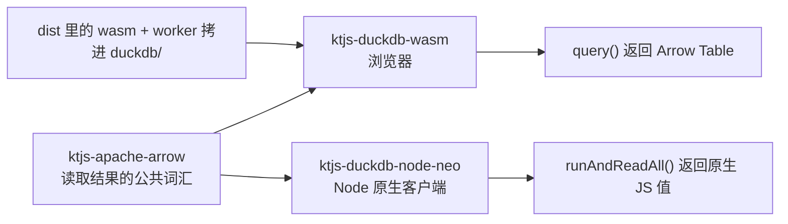

# 快速开始

三个模块发布在 Maven Central，本身是普通 Kotlin/JS 库：它们把上游 npm 包声明为依赖，Kotlin/JS 会自动安装。

## 添加依赖

```kotlin title="build.gradle.kts"
plugins {
    kotlin("multiplatform")
}

kotlin {
    js {
        browser()
    }

    sourceSets {
        jsMain.dependencies {
            // Arrow 是另外两个模块的共同词汇表。
            implementation("io.github.shijianjs:ktjs-apache-arrow:21.2.0-kt.1")
            // 浏览器版本……
            implementation("io.github.shijianjs:ktjs-duckdb-wasm:1.32.0-kt.1")
            // ……或 Node 原生客户端；两者并不冲突，但页面用不到 Node 版。
            implementation("io.github.shijianjs:ktjs-duckdb-node-neo:2.0.0-r.1-kt.1")
        }
    }
}
```

`repositories { }` 里只要有 `mavenCentral()` 即可，其余没有额外仓库。npm 侧的 `apache-arrow`、
`@duckdb/duckdb-wasm`、`@duckdb/node-api` 由 klib 元数据带入，公司内网镜像按常规方式配置
（`npm_config_registry` 或 `.npmrc`）。



## 浏览器里跑第一条查询

每个方法都返回 JS `Promise`，所以下面这条链就是完整流程：实例化模块、打开数据库、建立连接、执行查询，
然后读取返回的 Arrow 表。

```kotlin
import io.github.shijianjs.ktjs.duckdb.wasm.AsyncDuckDB
import io.github.shijianjs.ktjs.duckdb.wasm.DuckDBConfig
import io.github.shijianjs.ktjs.duckdb.wasm.LogLevels
import io.github.shijianjs.ktjs.duckdb.wasm.consoleLogger
import js.objects.unsafeJso
import web.workers.Worker

fun runQuery() {
    // worker 脚本与 .wasm 模块就是演示页从 `duckdb/` 提供的两个文件。
    // 按页面基准地址解析：在 worker 内，裸相对路径会以 worker 脚本所在目录为基准。
    val base = document.baseURI
    val worker = Worker(base + "duckdb/duckdb-browser-mvp.worker.js")
    val db = AsyncDuckDB(consoleLogger(LogLevels.WARNING), worker)

    db.instantiate(base + "duckdb/duckdb-mvp.wasm")
        .then { db.open(unsafeJso<DuckDBConfig> { path = ":memory:" }) }
        .then { db.connect() }
        .then { connection ->
            connection.query("SELECT 42 AS answer").then { table ->
                // `table` 是 Arrow 表：通过 arrow 模块读取。
                val answer = table.getChildAt(0.0)?.get(0.0)
                println("answer = $answer")
                connection.close()
            }
        }
}
```

`query()` 解析为 Arrow 的 `Table`，其列是带类型的向量：`getChildAt` 取出某一列，`get(row)` 取出该行的值。

## Node 里跑第一条查询

```kotlin
import io.github.shijianjs.ktjs.duckdb.node.DuckDBNodeApi

fun count() {
    DuckDBNodeApi.DuckDBInstance.create(null) // `:memory:`
        .then { instance ->
            instance.connect().then { connection ->
                connection.runAndReadAll("SELECT count(*) FROM range(0, 1000)").then { reader ->
                    val rows = reader.value(0.0, 0.0).unsafeCast<Int>()
                    println("rows = $rows")
                    reader.closeSync()
                    connection.closeSync()
                    instance.closeSync()
                }
            }
        }
}
```

Node 客户端返回的是原生 `BigInt` / `number` / `string`，而不是 Arrow，所以 node 模块取结果时并不依赖
arrow 模块——只在需要共用类型词汇时才依赖。

## 提供 WASM 文件

`@duckdb/duckdb-wasm` 在 `dist/` 里提供 `duckdb-mvp.wasm`（或 `duckdb-eh.wasm`）与配套的 worker 脚本。
把它们拷进页面的静态资源，再让 `instantiate` 和 `new Worker` 指向这些文件；接受 CDN 时也可用
`getJsDelivrBundles()`。仓库里的 demo 模块用 Gradle 完成拷贝，可直接照抄：

```kotlin title="build.gradle.kts"
val duckdbAssets = tasks.register<Copy>("duckdbAssets") {
    dependsOn(":kotlinNpmInstall")
    from(rootProject.layout.buildDirectory.dir("js/node_modules/@duckdb/duckdb-wasm/dist")) {
        include("duckdb-mvp.wasm", "duckdb-browser-mvp.worker.js")
        include("duckdb-eh.wasm", "duckdb-browser-eh.worker.js")
    }
    // `duckdb/` 属于目标路径的一部分，因为页面按 `duckdb/<文件>` 引用。
    into(layout.buildDirectory.dir("generated/duckdb-assets/duckdb"))
}

kotlin.js.sourceSets.jsMain.resources.srcDir(layout.buildDirectory.dir("generated/duckdb-assets"))
tasks.named("jsProcessResources") { dependsOn(duckdbAssets) }
```

多线程（`coi`）bundle 还要求页面处于跨源隔离状态（COOP/COEP 响应头）；`mvp` bundle 在任何环境都能跑。

## 声明遵循的约定

- 上游建模为数值枚举的值类型，一律是 `sealed external interface` + `Double` 工厂 + 常量对象
  （`Types.Int32`、`LogLevels.WARNING`），而不是 Kotlin `enum class`。
- 字符串字面量联合是 `sealed external interface` + `Xxxs` 常量对象（`IPCTypes.file`、
  `JSONTableShapes.ROW_ARRAY`）。
- 选项对象用 `js.objects.unsafeJso { … }` 构造，与 kotlin-wrappers 构造 DOM 选项的方式一致。
- 上游写 `unknown` 的成员保留 `JsAny`，并在 KDoc 里说明；其余成员一律不收宽。
